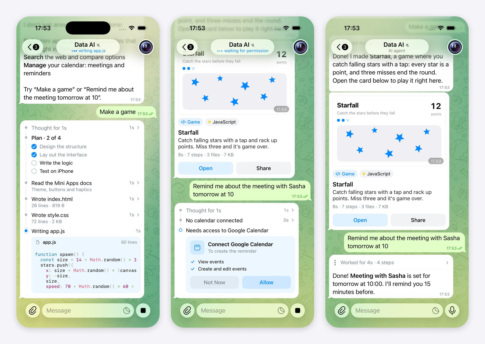

# AI Agent Chats for Telegram iOS



A chat with an AI agent that shows the work, not just a "typing…" indicator. While the agent works, its message
shows a live path: what it is thinking, its plan, the tools it calls and the code it is writing. When it finishes,
the path folds into one line above the answer, and the result arrives as a card you can open.

## Why

Telegram bots can already answer like AI assistants. Agents go further: they take several steps, call tools, write
code and ask for access to other services. A "typing…" indicator hides all of that, so the user waits without
knowing what is going on, and gets a file at the end with no context.

This concept gives agent work a native shape in the chat: you can see what the agent is doing, stop it, allow it to
connect a service, and open what it made.

## What it does

- **Path of work.** The agent's message holds a vertical timeline: thinking (tap to read it), a plan checklist,
  tool steps with their input and output, code being typed live, a failed step and its retry, and permission
  requests. Long paths fold into "+3 steps". When the agent is done, the path collapses to
  "Worked for 27s · 7 steps" above the answer, and a tap opens it again.
- **Live status.** The chat header and the chat list show what the agent is doing ("writing app.js",
  "waiting for permission") where "typing…" would be.
- **Result cards.** A project card shows a still frame of the app in use, its type, its main language with
  GitHub's colour, and what it took ("27s · 7 steps · 3 files · 7 KB"). **Open** slides the project up like a
  Mini App, with Preview, Code and Details tabs. A reminder arrives as an event card.
- **Permission requests.** The agent asks to connect a service (Google Calendar) right in its path.
  **Allow** continues the run, **Not Now** ends it politely.
- **Stop and queue.** The send button turns into Stop while the agent works. A message sent meanwhile is shown at
  once and answered next.
- **Agent identity.** Bots whose username ends in `_ai` appear as an AI agent: "Data AI" with its own avatar,
  "AI agent" in the header and the profile, and no Mini App button beside the input.
- **ASCII touches.** Code types with a block cursor, the summary line decodes into place, and the project preview
  resolves out of ASCII dither. Each one is small and can be switched off.
- **Settings ▸ Additions.** A switch for each addition (AI Agent Style, ASCII Animations, Demo Agent), the demo
  agent's speed, and a reset. With everything off, the app is plain Telegram.

## How it works

- **A run is a message.** The agent's work is one incoming message in the bot chat. An `AgentDemoMessageAttribute`
  carries the run (steps, plan, permission, timings) as JSON, and `ChatMessageAgentRunBubbleContentNode` draws it.
  The answer below the path streams in the way a bot's streaming reply does. The messages are stored in
  `Namespaces.Message.Local`, so nothing reaches the bot.
- **Only milestones are stored.** A step starting or finishing, a permission answer and a chunk of the answer are
  written to the database. Everything per frame (timers, pulses, typing code, the preview reveal) is derived from
  timestamps in the view.
- **Live status.** The demo engine publishes what each agent is doing. The chat header shows it as a typing-style
  activity with its own text. The chat list shows it in the typing row: bots have no online status, so the row asks
  the agent's status directly.
- **Cards and the project sheet.** `AgentArtifactCardView` lays its card out off the main thread. The preview is a
  WKWebView snapshot of the generated page, themed with Telegram's `--tg-theme-*` variables. The sheet is an
  `AttachmentController` in standalone mode, so it opens like a Mini App. The Code tab uses Telegram's own syntax
  highlighter.
- **ASCII reveal.** `AsciiRevealCore` is a deterministic port of the timing and glyph logic of
  [ascii-reveal](https://github.com/quanhoangindex/ascii-reveal) (MIT), and `AsciiReveal` draws it with Core Graphics
  only while an effect runs.
- **Identity.** `EnginePeer.isAIAgentBot` (username ends in `_ai`) decides it. `LocalizedPeerData` gives the
  agent its title and `AvatarNode` draws its picture, so every screen that names or draws the bot follows.
- **The demo agent.** `AgentDemoPlanner` reads the request and builds a path of work that fits it. It runs only
  in the simulator, and its content is made up.

The patch also fixes the Stop button in the input panel, which showed as an empty circle on iOS 26: its icon is now
drawn the way the attachment button's is.

## Repository

- `changes.patch` is the whole feature as one patch against Telegram-iOS: 58 files, +8623 −11.
- `Sources/` holds the new files from the patch, grouped by module, for reading.
- `Media/preview.png` shows the path of work, a permission request and the result cards.

## Changes

| Area | Files |
| --- | --- |
| New modules | `ConceptFeatures`, `AIAgent/AIAgentModel`, `AIAgent/AsciiRevealCore`, `AIAgent/AsciiReveal`, `AIAgent/AIAgentUI`, `AIAgent/AIAgentScreens`, `AIAgent/AIAgentCore`, `Chat/ChatAgentMessageNodes`, avatar asset `Avatar/DataAIAvatar` |
| TelegramCore | `SyncCore_AgentDemoMessageAttribute.swift` and `TelegramEngine/AIAgentDemo` (new), `AccountManager.swift`, `TelegramEngine.swift` |
| Chat | `ChatController.swift`, `Chat/ChatControllerLoadDisplayNode.swift`, `ChatControllerContentData.swift`, `ChatHistoryEntriesForView.swift`, `AIAgent/ChatControllerAIAgent.swift` (new), `ChatMessageBubbleItemNode`, `ChatMessageTextBubbleContentNode`, `ChatTextInputActionButtonsNode`, `ChatTitleComponent` |
| Chat list | `ChatListItem.swift`, `ChatListItemStrings.swift`, `ChatListNode.swift`, `ChatListTypingNode.swift` |
| Identity | `AvatarNode.swift`, `LocalizedPeerData/PeerTitle.swift` |
| Profile and Settings | `PeerInfoData.swift`, `PeerInfoScreen.swift`, `PeerInfoScreenSettingsActions.swift`, `PeerInfoSettingsItems.swift`, `ConceptSettingsScreen.swift` (new) |
| Build | `BUILD` files of the modules above |

## Trying it

This is not a standalone app. Apply the patch to a checkout of
[TelegramMessenger/Telegram-iOS](https://github.com/TelegramMessenger/Telegram-iOS) at `master` `fb0e62b`
(Telegram 13.1.1, October 22, 2026):

```sh
git apply changes.patch
```

Then build for the **iOS Simulator** as usual; the demo agent only runs there. Open a chat with any bot whose
username ends in `_ai` and send one of these:

- `What can you do?`
- `Make a game`
- `Remind me about the meeting with Sasha tomorrow at 10`
- `Find cheap flights to Istanbul`

Settings ▸ Additions switches each part on and off and sets the demo agent's speed.

Host tests cover the model and the reveal timing: `AIAgentModelTests` (planner, formatting, payloads) and
`AsciiRevealCoreTests`.

## Limitations

- The agent is a local, scripted demo. It understands a handful of requests (build a game, site or mini app; a
  calendar reminder; a flight search; a greeting; "what can you do") and plays a prepared path. A real agent would
  send the same structure from the server.
- The demo's messages are local to the device and are never sent.
- While the demo agent is on, its chat shows only the agent's conversation: the bot's real messages are hidden, not
  deleted.
- Every `_ai` bot is shown as the same agent, "Data AI". A real version would use each bot's own name and photo.
- The texts are in the code (English, with Russian variants), not in the language packs.
- Checked on the iPhone 17 Pro simulator (iOS 26.3) with Xcode 27.1.

## License

GPL-2.0, the license of Telegram-iOS. `AsciiRevealCore` ports logic from ascii-reveal, which is MIT-licensed.
